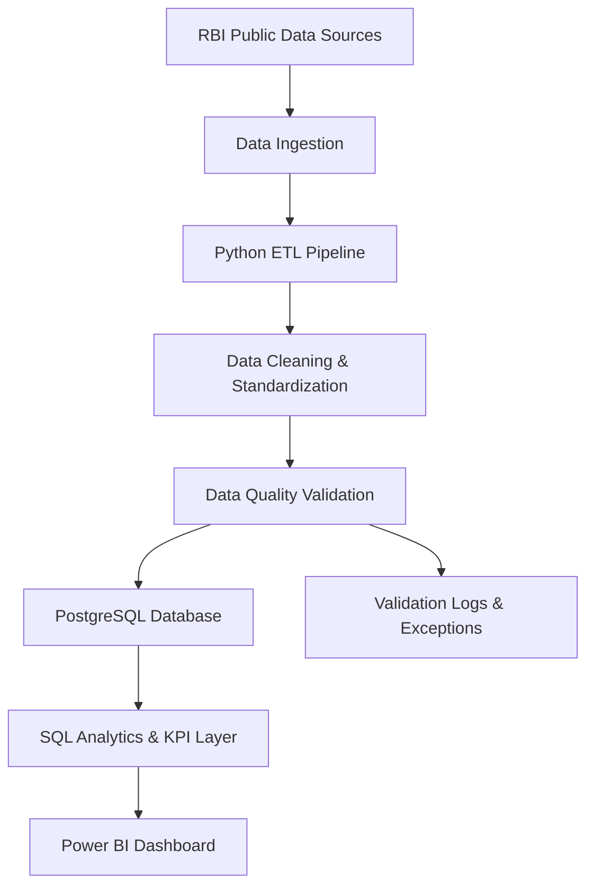

# RBI Payments Analytics

**An end-to-end financial data analytics pipeline built using publicly available Reserve Bank of India (RBI) payment-system statistics.**


> **Status:** In Development

---

## 1. Project Overview

RBI Payments Analytics is an end-to-end financial data analytics project that processes publicly available RBI payment-system statistics to analyze India's digital payment ecosystem.

The project focuses on transaction volume, monetary value, payment-channel performance, historical trends, and financial KPIs.

**Core workflow:**

RBI Data → Python ETL → Data Validation → PostgreSQL → SQL Analytics → Power BI

### Business Objectives

- Analyze digital payment trends across different payment channels.
- Compare transaction volume and monetary value.
- Identify monthly and yearly growth patterns.
- Build reliable, analysis-ready financial datasets.
- Develop interactive banking analytics dashboards.

## 2. Data Sources

**Primary source:** [RBI Database on Indian Economy](https://data.rbi.org.in/)

| Dataset | Analysis |
|---|---|
| Payment System Indicators | Overall payment activity |
| UPI Statistics | Digital payment trends |
| IMPS Statistics | Immediate payment activity |
| NEFT Statistics | Electronic fund transfers |
| RTGS Statistics | High-value transactions |
| Card Payment Statistics | Card transaction trends |

*Only datasets actually processed in the project should be listed as completed sources.*

## 3. System Architecture



### Pipeline Components

| Layer | Implementation |
|---|---|
| Data Ingestion | CSV / Excel processing |
| ETL | Python, Pandas, NumPy |
| Validation | Missing values, duplicates, data types |
| Storage | PostgreSQL |
| Analytics | SQL queries and aggregations |
| Visualization | Power BI and DAX |

## 4. Data Engineering & Database Design

### Python ETL

The Python processing layer handles:

- Dataset ingestion and column standardization.
- Date and numerical data-type conversion.
- Duplicate and missing-value identification.
- Financial unit standardization.
- Validation and exception handling.
- Loading processed records into PostgreSQL.

### Database Structure

| Table | Purpose |
|---|---|
| `raw_payment_data` | Original imported records |
| `dim_date` | Reporting date information |
| `dim_payment_channel` | Payment channel reference |
| `fact_payment_transactions` | Standardized aggregate payment data |
| `data_quality_log` | Validation exceptions |

*Proposed logical structure; adjust to match the implemented database schema.*

### Data Quality Checks

| Check | Purpose |
|---|---|
| Null Validation | Identify missing fields |
| Duplicate Detection | Prevent repeated observations |
| Date Validation | Verify reporting periods |
| Type Validation | Ensure correct data types |
| Unit Validation | Maintain consistent financial units |
| Reconciliation | Compare source and processed totals |

## 5. SQL Analytics & Financial KPIs

SQL is used to aggregate payment statistics, compare payment channels, and calculate financial indicators.

### Key Metrics

| KPI | Calculation |
|---|---|
| Total Transactions | SUM(Transaction Volume) |
| Total Transaction Value | SUM(Transaction Value) |
| Average Transaction Value | Total Value / Total Transactions |
| MoM Growth | Current Month vs Previous Month |
| YoY Growth | Current Year vs Previous Year |
| Channel Contribution | Channel Value / Total Value × 100 |

### Example: Payment Channel Analysis

```sql
SELECT
    channel_name,
    SUM(transaction_volume) AS total_transactions,
    SUM(transaction_value) AS total_value
FROM fact_payment_transactions
GROUP BY channel_name
ORDER BY total_transactions DESC;
```

### Example: Monthly Payment Trends

```sql
SELECT
    EXTRACT(YEAR FROM reporting_date) AS year,
    EXTRACT(MONTH FROM reporting_date) AS month,
    channel_name,
    SUM(transaction_volume) AS transaction_volume,
    SUM(transaction_value) AS transaction_value
FROM fact_payment_transactions
GROUP BY year, month, channel_name
ORDER BY year, month;
```

*Ensure that transaction volume and value use compatible units before calculating average transaction value.*

## 6. Power BI Dashboard

The Power BI reporting layer provides an interactive view of India's payment ecosystem.

### Dashboard Components

- **Executive Overview:** Total transaction volume, value, and key KPIs.
- **Payment Channel Analysis:** Comparison of UPI, IMPS, NEFT, RTGS, and card activity.
- **Growth Analysis:** Monthly and yearly transaction trends.
- **Transaction Value Analysis:** Monetary value and average transaction size.

### Visualizations

- KPI Cards
- Monthly Trend Line Charts
- Payment Channel Comparison
- Transaction Value Analysis
- Channel Contribution
- Date and Payment Channel Slicers

### Dashboard Preview

<!-- Add actual dashboard screenshots -->


## 7. Results & Evaluation

Project metrics will be populated using actual pipeline execution and validation results.

| Metric | Result |
|---|---|
| Source datasets processed | TBD |
| Total records processed | TBD |
| Payment channels analyzed | TBD |
| Data quality pass rate | TBD |
| Duplicate records detected | TBD |
| Missing values detected | TBD |
| Historical data coverage | TBD |
| Pipeline execution time | TBD |

### Evaluation Approach

- Compare source and processed record counts.
- Validate financial aggregations against source totals.
- Measure duplicate and missing-value rates.
- Verify SQL KPI calculations.
- Record pipeline execution time.

No unverified performance improvements or business-impact percentages are claimed.

## 8. Tech Stack & Project Structure

### Technology Stack

| Technology | Purpose |
|---|---|
| Python | ETL and data processing |
| Pandas & NumPy | Data manipulation |
| PostgreSQL | Database management |
| SQL | Financial analytics |
| Power BI | Dashboard development |
| DAX | KPI calculations |
| Git & GitHub | Version control |

### Project Structure

```text
rbi-payments-analytics/
│
├── data/
│   ├── raw/
│   └── processed/
│
├── notebooks/
│   └── exploratory_analysis.ipynb
│
├── src/
│   ├── ingestion/
│   ├── preprocessing/
│   ├── validation/
│   └── transformation/
│
├── sql/
│   ├── schema.sql
│   ├── transformations.sql
│   └── kpi_queries.sql
│
├── dashboards/
│   └── screenshots/
│
├── tests/
├── requirements.txt
├── .env.example
└── README.md
```

## 9. Setup, Roadmap & Author

### Installation

**1. Clone the repository**

```bash
git clone https://github.com/adiii-dhande/rbi-payments-analytics.git
cd rbi-payments-analytics
```

**2. Create a virtual environment**

```bash
python -m venv venv
venv\Scripts\activate
```

**3. Install dependencies**

```bash
pip install -r requirements.txt
```

**4. Configure database credentials**

Create a `.env` file:

```env
DB_HOST=localhost
DB_PORT=5432
DB_NAME=rbi_payments
DB_USER=postgres
DB_PASSWORD=your_password
```

**5. Initialize database**

```sql
CREATE DATABASE rbi_payments;
```

**6. Execute the pipeline**

```bash
python -m src.ingestion.load_data
```

*Update execution commands to match the actual implementation.*

### Roadmap

- [ ] Complete RBI dataset ingestion.
- [ ] Implement Python ETL and preprocessing.
- [ ] Implement PostgreSQL database schema.
- [ ] Add automated data-quality validation.
- [ ] Develop financial SQL queries.
- [ ] Build Power BI dashboards.
- [ ] Add automated pipeline testing.
- [ ] Implement scheduled data ingestion.

### Limitations

- RBI public statistics generally contain aggregated data, not individual customer transactions.
- Historical coverage varies across payment channels.
- Different datasets may use different reporting units.
- Analytical conclusions depend on source-data availability and quality.

### Author

**Aditya Dhande**

- GitHub: [adiii-dhande](https://github.com/adiii-dhande)
- LinkedIn: [Aditya Dhande](https://linkedin.com/in/aditya-dhande-data)
- Portfolio: [adidhande.lovable.app](https://adidhande.lovable.app)

---

<p align="center">
  <b>RBI Payments Analytics</b><br>
  Transforming public financial data into structured banking insights.
</p>
