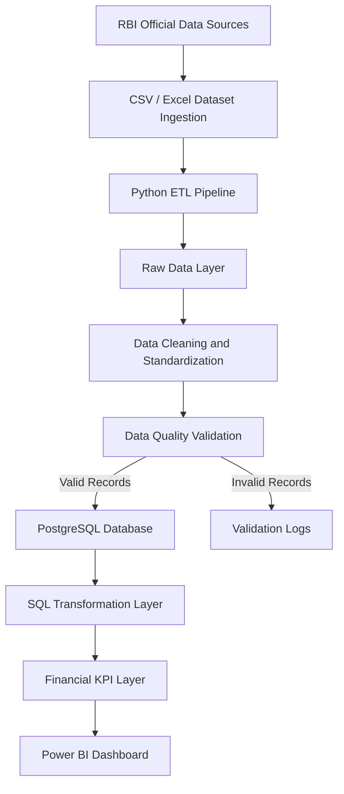
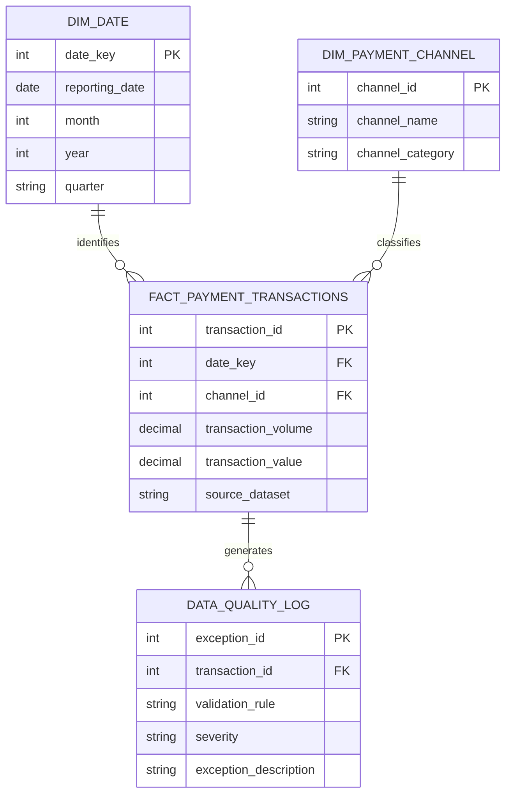

# RBI Payments Analytics

### Engineering an End-to-End Financial Data Analytics Pipeline Using Reserve Bank of India (RBI) Payment System Statistics

<p align="center">
  
  
  
  
  
  
  
</p>

> **Project status:** In development. Implementation status, analytical results, and performance metrics are reported only after execution and verification.

---

## Table of Contents

- [Overview](#overview)
- [Business Problem](#business-problem)
- [Project Objectives](#project-objectives)
- [Data Sources](#data-sources)
- [System Architecture](#system-architecture)
- [Data Engineering Workflow](#data-engineering-workflow)
- [Data Processing and Transformation](#data-processing-and-transformation)
- [Database Architecture](#database-architecture)
- [Data Quality and Validation](#data-quality-and-validation)
- [Financial and Analytical KPIs](#financial-and-analytical-kpis)
- [SQL Analytics](#sql-analytics)
- [Power BI Dashboard](#power-bi-dashboard)
- [Evaluation and Results](#evaluation-and-results)
- [Technical Design Decisions](#technical-design-decisions)
- [Technology Stack](#technology-stack)
- [Project Structure](#project-structure)
- [Installation and Setup](#installation-and-setup)
- [Execution Guide](#execution-guide)
- [Security and Data Governance](#security-and-data-governance)
- [Limitations](#limitations)
- [Roadmap](#roadmap)
- [Testing Strategy](#testing-strategy)
- [Contributing](#contributing)
- [License](#license)
- [Author](#author)

---

## 1. Overview

India's digital payment infrastructure has evolved into a large-scale financial ecosystem involving multiple payment channels, including Unified Payments Interface (UPI), Immediate Payment Service (IMPS), National Electronic Funds Transfer (NEFT), Real Time Gross Settlement (RTGS), and card-based transactions.

The increasing adoption of digital payments generates substantial financial statistics that can be used to understand transaction activity, payment-channel distribution, monetary movement, and changes in the Indian banking ecosystem.

However, meaningful financial analysis requires more than visualizing transaction numbers. It requires structured data ingestion, consistent financial units, reliable transformations, validation controls, and reproducible analytical calculations.

**RBI Payments Analytics** is an end-to-end financial data analytics project designed to process publicly available payment-system statistics published by the Reserve Bank of India.

The solution establishes a structured workflow that transforms raw financial datasets into validated analytical tables and business intelligence reports.

### Core Workflow

```text
RBI Public Data
      |
      v
Data Ingestion
      |
      v
Python ETL Pipeline
      |
      v
Data Cleaning and Standardization
      |
      v
Data Quality Validation
      |
      v
PostgreSQL Database
      |
      v
SQL Analytics and KPI Development
      |
      v
Power BI Dashboard
```

The project focuses on demonstrating practical financial data engineering, SQL-based analytical processing, data quality management, and business intelligence development.

---

## 2. Business Problem

Financial institutions and banking analysts require reliable information to understand payment-system performance and changes in digital transaction activity.

However, publicly available financial statistics may be distributed across different datasets, reporting periods, categories, and measurement units.

Analyzing these datasets independently introduces several challenges:

| Challenge | Business Implication |
|---|---|
| Distributed data sources | Difficult to consolidate financial information |
| Inconsistent reporting structures | Complicates cross-dataset analysis |
| Different measurement units | Can produce misleading comparisons |
| Missing or duplicate records | Reduces analytical reliability |
| Manual data preparation | Increases repetitive processing effort |
| Limited consolidated reporting | Makes trend identification difficult |
| Historical data inconsistencies | Complicates period-over-period comparisons |

### Proposed Solution

Develop a centralized financial analytics pipeline that:

1. Collects payment-system statistics from official RBI sources.
2. Processes raw CSV and Excel datasets using Python.
3. Standardizes dates, payment categories, and financial measurement units.
4. Applies validation checks to identify inconsistent records.
5. Stores structured data in PostgreSQL.
6. Uses SQL to calculate financial and operational indicators.
7. Connects analytical tables to Power BI for reporting.
8. Maintains traceability between source data and transformed outputs.

**Expected outcome:** A reproducible analytical workflow that improves the consistency, accessibility, and interpretability of RBI payment-system statistics.

---

## 3. Project Objectives

### Data Engineering

- Build a structured ingestion workflow for RBI datasets.
- Develop reusable Python-based preprocessing components.
- Standardize financial records across supported datasets.
- Separate raw, processed, and analytical data layers.

### Database Engineering

- Design relational structures for financial statistics.
- Implement appropriate primary and foreign key constraints.
- Develop SQL transformations and analytical queries.
- Maintain consistent reporting periods and payment categories.

### Data Quality

- Detect missing and duplicate records.
- Validate numerical and date fields.
- Identify unexpected negative values.
- Reconcile processed data against source totals.
- Maintain validation logs and exception records.

### Financial Analytics

- Analyze digital payment transaction growth.
- Compare payment-channel performance.
- Examine transaction volumes and monetary values.
- Calculate average transaction values.
- Identify monthly and yearly trends.

### Business Intelligence

- Develop interactive Power BI reports.
- Implement reusable DAX measures.
- Provide financial KPI summaries.
- Enable period and payment-channel comparisons.

---

## 4. Data Sources

### Primary Data Provider

**Reserve Bank of India (RBI)**

Official source:

https://data.rbi.org.in/

RBI publishes financial and banking statistics through its Database on Indian Economy and other official statistical publications.

### Potential Dataset Categories

| Dataset | Analytical Application |
|---|---|
| Payment System Indicators | Overall payment ecosystem analysis |
| UPI Statistics | Digital payment activity and adoption |
| IMPS Statistics | Immediate payment transaction trends |
| NEFT Statistics | Electronic funds transfer activity |
| RTGS Statistics | High-value settlement activity |
| Card Payment Statistics | Debit and credit card transaction analysis |

> Only datasets actually downloaded and incorporated into the implementation should be listed as processed sources.

### Source Data Characteristics

| Attribute | Description |
|---|---|
| Publisher | Reserve Bank of India |
| Data category | Banking and payment statistics |
| Geographic coverage | India |
| Data format | CSV / Excel / published statistical tables |
| Reporting frequency | Depends on the source dataset |
| Measures | Transaction count and monetary value |
| Data granularity | Aggregate statistical observations |

### Important Data Considerations

Different payment systems may report statistics using different units and conventions.

For example:

- Transaction volume may be expressed in millions or thousands.
- Transaction value may be reported in ₹ crore or another unit.
- Reporting periods may be monthly, quarterly, or annual.
- Some statistics may represent transactions while others represent settlement activity.

All transformations must preserve the original source units and document any conversions.

---

## 5. System Architecture

The architecture separates source ingestion, processing, validation, storage, analytics, and visualization.

### High-Level Architecture



### Architecture Components

| Component | Responsibility |
|---|---|
| RBI Data Sources | Provide original financial statistics |
| Ingestion Layer | Import source datasets |
| Python ETL | Process and standardize data |
| Raw Layer | Preserve original source records |
| Validation Layer | Detect data-quality issues |
| PostgreSQL | Store structured financial data |
| SQL Layer | Perform analytical transformations |
| KPI Layer | Calculate financial indicators |
| Power BI | Present interactive analytical reports |
| Validation Logs | Record data-quality exceptions |

### Data Flow

**Stage 1 — Source Acquisition**

Download the required datasets from official RBI sources.

**Stage 2 — Ingestion**

Read supported CSV and Excel files using Python.

**Stage 3 — Processing**

Clean column names, normalize date formats, standardize categories, and handle numerical values.

**Stage 4 — Validation**

Execute structural and business-rule validation checks.

**Stage 5 — Storage**

Load validated records into PostgreSQL.

**Stage 6 — Analytics**

Execute SQL transformations and calculate financial KPIs.

**Stage 7 — Visualization**

Connect Power BI to analytical tables and create interactive reports.

---

## 6. Data Engineering Workflow

The pipeline follows a logical separation of raw, processed, and analytical data.

### 6.1 Raw Data Layer

The raw layer preserves the original source information.

Responsibilities:

- Maintain original source files.
- Preserve source column names and reporting values.
- Record source filenames and ingestion metadata.
- Avoid modifying original financial values.
- Enable reproducibility during subsequent transformations.

### 6.2 Processing Layer

Python is responsible for transforming raw datasets into standardized records.

Typical operations:

- Column-name normalization.
- Data-type conversion.
- Date parsing.
- Missing-value identification.
- Duplicate detection.
- Payment-category standardization.
- Numerical unit normalization.
- Invalid-record identification.

### 6.3 Validation Layer

Before database loading, records are checked against defined structural and business rules.

Examples:

- Reporting dates must be valid.
- Transaction counts must follow the source's defined numerical conventions.
- Financial values must use documented units.
- Required fields must be present.
- Duplicate business keys must be identified.

### 6.4 Database Loading

Validated records are inserted into PostgreSQL.

The loading strategy should account for:

- Duplicate prevention.
- Database constraints.
- Transaction handling.
- Repeatable execution.
- Error logging.
- Source-to-database reconciliation.

### 6.5 Analytics Layer

SQL queries generate the analytical datasets used by Power BI.

Examples:

- Monthly payment statistics.
- Year-over-year growth.
- Payment-channel contribution.
- Average transaction value.
- Transaction value distribution.

---

## 7. Data Processing and Transformation

Python provides the data-processing layer.

### Core Libraries

| Library | Application |
|---|---|
| Pandas | Data ingestion and transformation |
| NumPy | Numerical operations |
| SQLAlchemy | Database connectivity |
| Psycopg | PostgreSQL integration |
| OpenPyXL | Excel file processing |

### Example Transformation Workflow

```python
import pandas as pd

def clean_payment_data(file_path):

    df = pd.read_csv(file_path)

    # Normalize column names
    df.columns = (
        df.columns
        .str.strip()
        .str.lower()
        .str.replace(" ", "_")
    )

    # Remove completely empty records
    df = df.dropna(how="all")

    # Standardize reporting dates
    df["reporting_date"] = pd.to_datetime(
        df["reporting_date"],
        errors="coerce"
    )

    # Identify duplicate records
    duplicates = df.duplicated()

    duplicate_records = df[duplicates].copy()

    # Keep unique records for further validation
    df = df.drop_duplicates()

    return df, duplicate_records
```

> Illustrative example only. Adapt the column names, duplicate keys, date formats, and cleaning rules to the actual RBI source files. Do not silently discard records that need investigation.

### Transformation Principles

1. Preserve original source information.
2. Apply transformations consistently.
3. Keep measurement units explicit.
4. Avoid unnecessary rounding.
5. Document business rules.
6. Maintain reproducible processing steps.

---

## 8. Database Architecture

PostgreSQL serves as the relational storage and analytical query layer.

The proposed database structure separates source-level information, reference dimensions, financial observations, and validation records.

### Proposed Logical Data Model



> This is a conceptual model. The implemented schema must reflect the actual source data. In particular, aggregated RBI observations must not be represented as individual customer transactions.

### Proposed Tables

| Table | Purpose |
|---|---|
| `raw_payment_data` | Imported source-level records |
| `dim_date` | Reporting calendar |
| `dim_payment_channel` | Payment category reference |
| `fact_payment_transactions` | Standardized aggregate payment observations |
| `data_quality_log` | Validation failures and exceptions |

### Database Design Considerations

- Use appropriate numeric types for financial measures.
- Avoid floating-point precision errors for financial values.
- Define appropriate unique constraints.
- Maintain source dataset references.
- Use indexes for frequently filtered reporting fields.
- Keep reporting periods consistent.

---

## 9. Data Quality and Validation

Data quality is a critical requirement for financial reporting.

Incorrect transaction values, duplicate observations, or inconsistent measurement units can produce misleading financial conclusions.

### Validation Framework

| Validation | Objective |
|---|---|
| Null Validation | Identify missing required fields |
| Duplicate Detection | Identify repeated observations |
| Data Type Validation | Verify numerical and date formats |
| Date Validation | Detect invalid reporting periods |
| Schema Validation | Ensure expected columns exist |
| Range Validation | Identify unexpected numerical values |
| Unit Validation | Prevent inconsistent measurement units |
| Referential Validation | Verify valid dimension references |
| Reconciliation | Compare source and processed totals |

### Exception Classification

| Severity | Meaning |
|---|---|
| Critical | Record cannot be safely processed |
| High | Significant financial or structural inconsistency |
| Medium | Potential reporting issue requiring review |
| Low | Non-critical formatting or metadata issue |

### Data Reconciliation

The pipeline should compare source and processed totals.

Example:

```text
Source Transaction Volume
          |
          v
Processed Transaction Volume
          |
          v
Difference Calculation
          |
          v
Reconciliation Status
```

A reconciliation failure should be investigated rather than hidden by automatically adjusting values.

### Data Quality Metrics

The following metrics should be calculated from actual execution logs:

| Metric | Calculation |
|---|---|
| Completeness | Valid required fields / Total required fields |
| Duplicate Rate | Duplicate observations / Total observations |
| Validation Pass Rate | Passed checks / Total checks |
| Reconciliation Difference | Source Total - Processed Total |
| Exception Rate | Records with exceptions / Total records |

---

## 10. Financial and Analytical KPIs

The analytical layer focuses on understanding India's payment-system activity.

### 10.1 Transaction Volume

Measures the number of transactions processed through supported payment channels.

```sql
SELECT
    channel_name,
    SUM(transaction_volume) AS total_transactions
FROM fact_payment_transactions
GROUP BY channel_name
ORDER BY total_transactions DESC;
```

### 10.2 Transaction Value

Measures the aggregate monetary value of payment transactions.

```sql
SELECT
    channel_name,
    SUM(transaction_value) AS total_transaction_value
FROM fact_payment_transactions
GROUP BY channel_name
ORDER BY total_transaction_value DESC;
```

### 10.3 Average Transaction Value

```sql
SELECT
    channel_name,
    SUM(transaction_value) /
    NULLIF(SUM(transaction_volume), 0)
        AS average_transaction_value
FROM fact_payment_transactions
GROUP BY channel_name;
```

> Ensure volume and value units are converted consistently before interpreting the result.

### 10.4 Month-over-Month Growth

\[
MoM\ Growth =
\frac{Current\ Month - Previous\ Month}
{Previous\ Month} \times 100
\]

### 10.5 Year-over-Year Growth

\[
YoY\ Growth =
\frac{Current\ Period - Previous\ Period}
{Previous\ Period} \times 100
\]

### 10.6 Payment Channel Contribution

\[
Channel\ Contribution =
\frac{Channel\ Transaction\ Value}
{Total\ Transaction\ Value} \times 100
\]

### Analytical Questions

The project is designed to investigate:

1. Which payment channels account for the largest transaction volume?
2. Which channels contribute the highest monetary value?
3. How has UPI transaction activity changed over time?
4. How do NEFT and RTGS differ in transaction value and volume?
5. Which payment channels demonstrate the strongest growth?
6. How has the composition of digital payments evolved?
7. Are there identifiable seasonal patterns in transaction activity?

These are analytical questions, not predetermined findings. Conclusions must come from the processed data.

---

## 11. SQL Analytics

SQL is used to create reusable analytical queries and reporting datasets.

### Analytical Query Categories

| Category | Analysis |
|---|---|
| Aggregation | Total volume and monetary value |
| Time Series | Monthly and yearly trends |
| Ranking | Payment-channel rankings |
| Window Functions | Period-over-period growth |
| CTEs | Multi-stage analytical calculations |
| Conditional Aggregation | Channel-specific reporting |
| Data Validation | Duplicate and inconsistency checks |

### Example: Monthly Payment Trends

```sql
SELECT
    EXTRACT(YEAR FROM reporting_date) AS year,
    EXTRACT(MONTH FROM reporting_date) AS month,
    channel_name,
    SUM(transaction_volume) AS total_volume,
    SUM(transaction_value) AS total_value
FROM fact_payment_transactions
GROUP BY
    EXTRACT(YEAR FROM reporting_date),
    EXTRACT(MONTH FROM reporting_date),
    channel_name
ORDER BY year, month, channel_name;
```

### Example: Payment Channel Ranking

```sql
SELECT
    channel_name,
    SUM(transaction_volume) AS total_volume,
    RANK() OVER (
        ORDER BY SUM(transaction_volume) DESC
    ) AS volume_rank
FROM fact_payment_transactions
GROUP BY channel_name;
```

> These examples assume the proposed column names and schema. Adjust them to the implemented database.

---

## 12. Power BI Dashboard

Power BI acts as the business intelligence and reporting layer.

The dashboard is intended to provide a consolidated view of payment-system performance.

### Planned Dashboard Components

| Dashboard | Purpose |
|---|---|
| Executive Overview | High-level payment ecosystem performance |
| Transaction Volume Analysis | Payment-channel transaction activity |
| Transaction Value Analysis | Monetary value comparisons |
| Growth Analysis | Monthly and yearly growth |
| Channel Comparison | Comparative payment-system performance |

### KPI Cards

- Total Transaction Volume
- Total Transaction Value
- Average Transaction Value
- Month-over-Month Growth
- Year-over-Year Growth
- Leading Payment Channel

### Planned Visualizations

- KPI cards for financial indicators.
- Line charts for historical trends.
- Clustered column charts for channel comparisons.
- Donut charts for payment-channel contribution.
- Matrix visuals for monthly and yearly reporting.
- Slicers for payment channel and reporting period.

### Dashboard Preview

<!-- Replace these placeholders with actual screenshots -->

<p align="center">
  
</p>

<p align="center">
  
</p>

<p align="center">
  
</p>

---

## 13. Evaluation and Results

Project performance should be evaluated using reproducible measurements rather than estimated business-impact claims.

### Data Processing Metrics

| Metric | Result |
|---|---|
| Source datasets processed | TBD |
| Total observations processed | TBD |
| Unique payment channels | TBD |
| Historical reporting coverage | TBD |
| Data validation pass rate | TBD |
| Duplicate observations identified | TBD |
| Missing values identified | TBD |
| Reconciliation accuracy | TBD |

### Pipeline Performance

| Metric | Result |
|---|---|
| Total execution time | TBD |
| Data ingestion time | TBD |
| Transformation time | TBD |
| Database loading time | TBD |
| Average processing throughput | TBD |

### Evaluation Methodology

1. Record the number of source observations.
2. Track the number of processed observations.
3. Calculate duplicate and missing-value rates.
4. Compare source and destination aggregates.
5. Validate analytical KPIs against independent SQL calculations.
6. Record execution time for each pipeline stage.

### Reproducibility

All reported measurements should be traceable to:

- Source dataset versions.
- Processing scripts.
- Database queries.
- Validation logs.
- Execution timestamps.

No performance improvements or financial savings are claimed without a measured baseline.

---

## 14. Technical Design Decisions

| Decision | Reasoning |
|---|---|
| RBI as the primary source | Uses official published financial statistics |
| Python for ETL | Supports flexible preprocessing and validation |
| PostgreSQL for storage | Provides relational integrity and SQL analytics |
| SQL for KPI calculations | Keeps financial calculations reproducible |
| Power BI for visualization | Enables interactive business reporting |
| Separate raw and processed data | Preserves source traceability |
| Validation before loading | Prevents known invalid records from entering analytical tables |
| Explicit unit documentation | Avoids misleading financial comparisons |

### Important Analytical Design Principles

**1. Preserve source-level values**

Original financial values should remain accessible for reconciliation.

**2. Standardize without losing meaning**

Conversions must be documented, particularly when transaction values use different monetary units.

**3. Separate ingestion from analytics**

Changes to dashboard requirements should not require rewriting the original ingestion process.

**4. Validate before reporting**

Data-quality failures should be visible and investigated.

**5. Keep calculations reproducible**

Financial KPIs should be traceable to SQL queries and source observations.

---

## 15. Technology Stack

| Layer | Technology | Purpose |
|---|---|---|
| Programming | Python 3.11+ | ETL and preprocessing |
| Data Manipulation | Pandas, NumPy | Data cleaning and transformations |
| Database | PostgreSQL | Relational data storage |
| Database Connectivity | SQLAlchemy / Psycopg | Database integration |
| Query Language | SQL | Analytical processing |
| Visualization | Power BI | Financial reporting |
| BI Calculations | DAX | Measures and KPIs |
| Source Data | RBI | Official financial statistics |
| Version Control | Git / GitHub | Code management |
| Testing | Pytest | Pipeline validation |

---

## 16. Project Structure

```text
rbi-payments-analytics/
│
├── data/
│   ├── raw/
│   ├── processed/
│   └── README.md
│
├── notebooks/
│   ├── exploratory_analysis.ipynb
│   └── data_quality_analysis.ipynb
│
├── src/
│   ├── __init__.py
│   │
│   ├── ingestion/
│   │   ├── __init__.py
│   │   └── load_data.py
│   │
│   ├── preprocessing/
│   │   ├── __init__.py
│   │   └── clean_data.py
│   │
│   ├── validation/
│   │   ├── __init__.py
│   │   └── validate_data.py
│   │
│   ├── transformation/
│   │   ├── __init__.py
│   │   └── transform_data.py
│   │
│   └── database/
│       ├── __init__.py
│       └── connection.py
│
├── sql/
│   ├── schema.sql
│   ├── transformations.sql
│   ├── kpi_queries.sql
│   └── validation_queries.sql
│
├── dashboards/
│   ├── screenshots/
│   └── rbi_payments_dashboard.pbix
│
├── reports/
│   ├── data_quality_report.md
│   └── execution_report.md
│
├── tests/
│   ├── test_ingestion.py
│   ├── test_preprocessing.py
│   └── test_validation.py
│
├── .env.example
├── .gitignore
├── requirements.txt
├── LICENSE
└── README.md
```

> This is a reference structure. Keep only files and directories that exist in the actual repository.

---

## 17. Installation and Setup

### Prerequisites

| Requirement | Version |
|---|---|
| Python | 3.11+ |
| PostgreSQL | 14+ |
| Power BI Desktop | Current supported version |
| Git | Current stable version |

### Step 1: Clone the Repository

```bash
git clone https://github.com/adiii-dhande/rbi-payments-analytics.git

cd rbi-payments-analytics
```

### Step 2: Create a Virtual Environment

```bash
python -m venv venv
```

Activate on Windows:

```bash
venv\Scripts\activate
```

Activate on macOS / Linux:

```bash
source venv/bin/activate
```

### Step 3: Install Dependencies

```bash
pip install -r requirements.txt
```

### Step 4: Configure Environment Variables

Create a `.env` file based on `.env.example`.

```env
DB_HOST=localhost
DB_PORT=5432
DB_NAME=rbi_payments
DB_USER=postgres
DB_PASSWORD=your_password
```

Do not commit `.env` to version control.

### Step 5: Create the Database

```sql
CREATE DATABASE rbi_payments;
```

### Step 6: Initialize Database Schema

```bash
psql -U postgres -d rbi_payments -f sql/schema.sql
```

### Step 7: Execute the Pipeline

```bash
python -m src.ingestion.load_data
```

> Replace the execution command with the actual pipeline entry point implemented in the repository.

---

## 18. Testing Strategy

Financial data pipelines require validation at multiple stages.

### Unit Testing

Test individual processing functions:

- File ingestion.
- Column standardization.
- Date conversion.
- Duplicate identification.
- Numerical validation.

### Integration Testing

Validate interactions between:

- Python and PostgreSQL.
- ETL transformations and database tables.
- SQL analytical views and source observations.

### Data Reconciliation Testing

Compare original source totals against processed database totals.

### Analytical Testing

Independently verify:

- Transaction volume aggregations.
- Transaction value aggregations.
- Average transaction values.
- Growth calculations.
- Channel contribution percentages.

### Example Test Execution

```bash
pytest tests/ -v
```

Only tests that have actually been implemented and executed should be reported as passing.

---

## 19. Security and Data Governance

Although the project uses publicly available aggregate statistics, the pipeline should follow sound data-management practices.

- Store credentials in environment variables.
- Exclude secrets and local configuration files from Git.
- Preserve source dataset references.
- Maintain transformation documentation.
- Record validation exceptions.
- Avoid modifying source files without traceability.
- Do not present aggregated statistics as confidential customer-level banking records.

### Data Handling

The project does not claim access to RBI internal systems, confidential banking infrastructure, or individual customer transaction records.

All analysis must remain within the scope of the publicly available source data.

---

## 20. Limitations

1. **Aggregate data:** Public RBI statistics generally do not expose individual customer-level transactions.

2. **Different reporting frequencies:** Historical coverage may differ between datasets.

3. **Measurement differences:** Transaction values and volumes may use different reporting units.

4. **Limited granularity:** Public aggregate statistics may not support customer segmentation or individual transaction analysis.

5. **Source revisions:** Published statistical values may be revised by the source provider.

6. **Causal inference:** Observed correlations between payment channels do not establish causal relationships.

7. **Historical completeness:** Some payment categories may not have identical historical coverage.

---

## 21. Roadmap

### Phase 1 — Data Foundation

- [ ] Identify and document official RBI datasets.
- [ ] Download and preserve source files.
- [ ] Implement Python ingestion.
- [ ] Standardize financial records.
- [ ] Implement validation checks.

### Phase 2 — Database Engineering

- [ ] Design PostgreSQL schema.
- [ ] Implement raw and processed data layers.
- [ ] Add primary and foreign key constraints.
- [ ] Implement repeatable database loading.
- [ ] Develop reconciliation queries.

### Phase 3 — Financial Analytics

- [ ] Develop transaction volume analysis.
- [ ] Develop transaction value analysis.
- [ ] Implement MoM and YoY growth.
- [ ] Implement channel contribution metrics.
- [ ] Validate analytical calculations.

### Phase 4 — Business Intelligence

- [ ] Build executive overview dashboard.
- [ ] Build payment-channel comparison dashboard.
- [ ] Implement DAX measures.
- [ ] Add reporting-period filters.
- [ ] Document key analytical findings.

### Phase 5 — Engineering Improvements

- [ ] Automate periodic data ingestion.
- [ ] Introduce incremental loading.
- [ ] Implement automated testing.
- [ ] Add pipeline execution logging.
- [ ] Containerize the application.
- [ ] Introduce scheduled pipeline execution.

---

## 22. Future Enhancements

Potential future improvements include:

- Automated source-data acquisition.
- Incremental ETL and change detection.
- Data-quality monitoring.
- Historical trend forecasting.
- Additional financial indicators.
- Docker-based deployment.
- Scheduled pipeline orchestration.
- Automated reporting and reconciliation.
- Expanded coverage of RBI banking statistics.

These are planned enhancements, not current capabilities unless explicitly implemented.

---

## 23. References

- [Reserve Bank of India](https://www.rbi.org.in/)
- [RBI Database on Indian Economy](https://data.rbi.org.in/)
- [PostgreSQL Documentation](https://www.postgresql.org/docs/)
- [Python Documentation](https://docs.python.org/3/)
- [Pandas Documentation](https://pandas.pydata.org/docs/)
- [Microsoft Power BI Documentation](https://learn.microsoft.com/power-bi/)

---

## 24. License

This project is licensed under the MIT License.

See the [LICENSE](LICENSE) file for details.

Source datasets remain subject to their respective publishers' terms and applicable usage conditions.

---

## 25. Author

**Aditya Dhande**

Electronics and Telecommunication Engineering | Data Analytics | Data Engineering

- **GitHub:** [adiii-dhande](https://github.com/adiii-dhande)
- **LinkedIn:** [Aditya Dhande](https://linkedin.com/in/aditya-dhande-data)
- **Portfolio:** [adidhande.lovable.app](https://adidhande.lovable.app)

---

<p align="center">
  <b>RBI Payments Analytics</b><br/>
  Turning public financial statistics into structured, validated, and actionable analytical insights.
</p>
