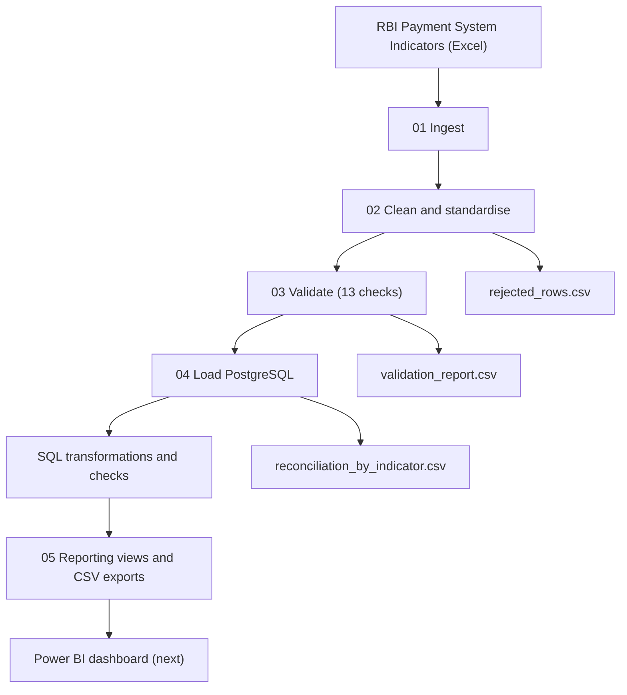

# RBI Payments Analytics

**An end-to-end data pipeline on the Reserve Bank of India's public payment-system statistics: Python ETL, automated data-quality validation, PostgreSQL, SQL KPIs and Power BI-ready datasets.**


> **Status:** Data pipeline, database and SQL analytics are complete and tested. The Power BI dashboard is the next step.

---

## 1. Project Overview

The RBI publishes monthly *Payment System Indicators*: transaction volume and value for RTGS, NEFT, IMPS, UPI, cards, prepaid instruments, ATMs and more. The source is one wide Excel sheet with multi-row headers and a numbered hierarchy, which makes it hard to analyse directly and easy to double count.

This project turns that sheet into trustworthy, analysis-ready data and proves it is trustworthy: every row is accounted for, hierarchy totals are reconciled, and the database is checked against the source.

**Workflow:** RBI Excel -> Python ETL -> data-quality validation -> PostgreSQL -> SQL analytics -> Power BI-ready CSVs

### Business objectives

* Compare payment channels by transaction volume and monetary value.
* Measure monthly and yearly growth (MoM, YoY, fiscal year).
* Build reliable datasets that cannot silently double count.
* Prepare a clean model for an interactive banking dashboard.

## 2. Data Source

| | |
|---|---|
| Source | [RBI Database on Indian Economy](https://data.rbi.org.in/) > Payment System Indicators (monthly) |
| File | `data/raw/rbi_payment_indicators_monthly.xlsx` |
| Coverage | 82 months, Nov 2019 to Aug 2026 |
| Content | 70 indicators x 2 measures (volume in lakh, value in INR crore) |
| Status of data | Provisional, as stated by the RBI |

All payment channels (UPI, IMPS, NEFT, RTGS, cards, PPI, ECS/NACH) come from this single file.

## 3. Architecture



| Layer | Implementation |
|---|---|
| Ingestion | Python, pandas, openpyxl: parses the multi-row header into a tidy table |
| Cleaning | Types, units, hierarchy, gap classification, outlier flags |
| Validation | 13 Python checks + 11 SQL checks + 3-way reconciliation |
| Storage | PostgreSQL star schema: staging, 2 dimensions, 1 fact, batch and quality logs |
| Analytics | SQL window functions (LAG, RANK, rolling averages) and views |
| Visualisation | Power BI (planned) |

## 4. Data Engineering and Database Design

### What the Python layer does

* Reads the sheet by locating the header rows, so a few added rows do not break it.
* Splits each header into code, name and footnote symbol; builds a stable key per indicator.
* Treats the RBI `-` marker as "not available" (never as zero) and classifies each gap as leading, trailing or interior.
* Rebuilds the hierarchy (Total > Group > Instrument > Sub-instrument) so queries never add parents and children together.
* Flags zeros and unusual month-on-month moves; removes nothing silently.
* Loads PostgreSQL idempotently: running the pipeline twice gives identical tables.

### Database

| Table | Grain |
|---|---|
| `stg_psi_long` | cleaned long rows, reloaded each run |
| `dim_indicator` | one row per indicator, with hierarchy attributes |
| `dim_date` | one row per month, Indian fiscal year (April-March) |
| `fact_payment_indicator` | month x indicator, volume and value side by side |
| `etl_batch_log` | one row per pipeline run |
| `data_quality_log` | every check result per run |

### Data quality checks

| Check | Result on the real data |
|---|---|
| Structure and units | 140 columns = 70 indicators x 2; all headers are lakh / INR crore |
| Months | 82 months, no gap |
| Cells | every cell is a number or the RBI `-` placeholder; 0 stray text |
| Duplicates | 0 |
| Negative values | 0 (396 zeros kept and flagged) |
| Hierarchy | 2,656 parent = sum-of-children comparisons across 19 parents: 0 violations |
| RBI totals | 492 comparisons: 3 violations, all Sep-2023 volume (see Findings) |
| Source vs processed vs database | 70 of 70 indicators match |
| Row accounting | 11,480 source cells = 10,362 cleaned rows + 1,118 rejected placeholders |

## 5. SQL Analytics and Financial KPIs

| KPI | Calculation |
|---|---|
| Total transactions / value | `volume_lakh`, `value_crore` of one indicator (never summed across hierarchy levels) |
| Average transaction value | `value_crore * 100 / volume_lakh` (rupees) |
| MoM and YoY growth | `LAG` window, only when the comparison month exists |
| Rolling 3-month average | `RANGE` window of 3 consecutive months |
| Channel contribution | indicator / Total Payments x 100, same month |
| Channel rank | `RANK()` by volume and by value within the month |
| Fiscal-year totals | April-March, YoY only between complete years |

```sql
-- Channel contribution: each group's share of Total Payments, latest month
WITH latest AS (SELECT max(month_date) AS m FROM fact_payment_indicator),
tot AS (
    SELECT f.volume_lakh AS tv, f.value_crore AS tc
    FROM fact_payment_indicator f JOIN dim_indicator i USING (indicator_id)
    WHERE i.indicator_code = 'total_payments_1_2_3_4_5_6' AND f.month_date = (SELECT m FROM latest)
)
SELECT i.code_number, i.indicator_name,
       round(100.0 * f.volume_lakh / NULLIF(t.tv, 0), 2) AS volume_share_pct,
       round(100.0 * f.value_crore / NULLIF(t.tc, 0), 2) AS value_share_pct
FROM fact_payment_indicator f
JOIN dim_indicator i USING (indicator_id)
CROSS JOIN tot t
WHERE f.month_date = (SELECT max(month_date) FROM fact_payment_indicator)
  AND i.kpi_scope = 'payment_system' AND i.analysis_role = 'group'
ORDER BY value_share_pct DESC;
```

All 10 analysis queries are in `SQL/04_kpi_queries.sql`; the reusable reporting views are in `SQL/05_views_for_powerbi.sql`.

## 6. Results and Findings

### Pipeline results (measured, not estimated)

| Metric | Result |
|---|---|
| Source datasets processed | 1 Excel file (135.4 KB) |
| Source cells read | 11,480 (82 months x 140 columns) |
| Cleaned rows | 10,362 |
| Rows rejected | 1,118 (RBI `-` placeholders: 464 not yet reported, 154 series ended, 500 interior gaps in sparse or discontinued series) |
| Duplicate records detected | 0 |
| Indicators / months | 70 / 82 (Nov 2019 to Aug 2026) |
| Python checks | 13 run: 10 passed, 2 warnings, 0 failed, 1 info |
| SQL checks | 11 run: 10 passed, 1 warning, 0 failed |
| Rows in PostgreSQL | staging 10,362; dim_indicator 70; dim_date 82; fact 5,606 |
| Reconciliation | 70 of 70 indicators match across source, processed and database |
| Unit tests | 10 passed |
| Pipeline run time | about 7 seconds end to end on the test machine |

### Findings from the data

* **UPI volume grew 20.1x**, from 12,188 lakh in Nov 2019 to 245,090 lakh in Aug 2026.
* **UPI share of digital payment volume rose from 40.65 percent to 87.10 percent.**
* **UPI average ticket fell from INR 1,553 to INR 1,217**, consistent with growth in small payments.
* **Volume and value tell different stories (Aug 2026):** RTGS is 0.11 percent of transactions but 68.49 percent of value; UPI is 86.98 percent of transactions but 9.92 percent of value.
* **UPI fiscal-year volume growth slowed** from +105.80 percent (FY2021-22) to +30.00 percent (FY2025-26).
* **Data issue found:** in Sep-2023 the RBI sheet has no Prepaid Payment Instruments *volume*, yet the reported totals include it, so total volume is 4.65 percent above the sum of the published groups (implied missing 6,143.16 lakh). Values reconcile exactly in all 82 months. The pipeline flags this instead of hiding it.

Numbers come from `documentation/pipeline_run_summary.md`, which the pipeline regenerates on every run.

## 7. Dashboard

The Power BI dashboard is the next step. The model, files and measures to use are prepared in `power_bi/README.md`, and the exports in `data/cleaned/vw_*.csv` are ready to import.

Planned pages: Executive Overview, Payment Channel Analysis, Growth Analysis, Transaction Value Analysis.

## 8. Tech Stack and Project Structure

| Technology | Purpose |
|---|---|
| Python, pandas, NumPy, openpyxl | ETL and validation |
| SQLAlchemy, psycopg2 | Database access |
| PostgreSQL | Storage and SQL analytics |
| pytest | Unit tests |
| Power BI, DAX | Dashboard (next) |
| Git and GitHub | Version control |

```text
rbi-payments-analytics/
├── data/
│   ├── raw/                 # RBI source file (+ earlier extracts used for cross-checks)
│   ├── interim/             # working files (git-ignored)
│   └── cleaned/             # analysis-ready CSVs, quality reports, Power BI exports
├── python/
│   ├── config.py  etl_lib.py
│   ├── 01_ingest.py  02_clean.py  03_validate.py  04_load_postgres.py  05_export_powerbi.py
│   └── run_pipeline.py
├── SQL/
│   ├── 00_reset_schema.sql  01_schema.sql  02_transformations.sql
│   └── 03_data_quality_checks.sql  04_kpi_queries.sql  05_views_for_powerbi.sql
├── tests/
├── documentation/           # data dictionary, quality rules, KPI definitions, runbook, run summary
├── power_bi/  power_query/  screenshots/
├── RUN_ORDER.md  PUSH_TO_GITHUB.md
├── requirements.txt  .env.example
└── README.md
```

## 9. Setup, Roadmap and Author

### Installation (Windows PowerShell)

```powershell
git clone https://github.com/adiii-dhande/rbi-payments-analytics.git
cd rbi-payments-analytics
py -3.11 -m venv .venv
.\.venv\Scripts\Activate.ps1
python -m pip install -r requirements.txt
Copy-Item .env.example .env        # then put your PostgreSQL password in .env
```

In pgAdmin create the database once: `CREATE DATABASE rbi_payments;`

### Run

```powershell
python -m pytest                              # 10 tests
python python/run_pipeline.py --reset-db      # ingest, clean, validate, load, export
python python/run_pipeline.py --skip-db       # steps 1-3 only, no database needed
```

Step-by-step guide with the expected output of every command: [RUN_ORDER.md](RUN_ORDER.md).

### Roadmap

- [x] RBI dataset ingestion
- [x] Python ETL and preprocessing
- [x] PostgreSQL database schema
- [x] Automated data-quality validation and reconciliation
- [x] Financial SQL queries and reporting views
- [x] Automated unit tests
- [ ] Build Power BI dashboards
- [ ] Schedule automated monthly ingestion
- [ ] Add CI to run the tests on every push

### Limitations

* RBI statistics are aggregated monthly figures, not individual customer transactions.
* The data are provisional and recent months can be revised.
* Coverage starts in Nov 2019; some instruments started later and some (ECS) were discontinued.
* The RBI definition of "digital" includes RTGS and NEFT, so the digital share is close to 100 percent by volume.
* Channel-view rows (mobile, internet, ATM) overlap with other indicators and are excluded from share-of-total calculations.
* Fiscal years FY2019-20 and FY2026-27 are partial and are not compared with full years.
* Pipeline timings and the 142 outlier flags depend on the thresholds in `python/config.py`.

### Author

**Aditya Dhande**

* GitHub: [adiii-dhande](https://github.com/adiii-dhande)
* LinkedIn: [Aditya Dhande](https://linkedin.com/in/aditya-dhande-data)
* Portfolio: [adidhande.lovable.app](https://adidhande.lovable.app)

---

<p align="center">
  <b>RBI Payments Analytics</b><br>
  Transforming public financial data into structured banking insights.
</p>
